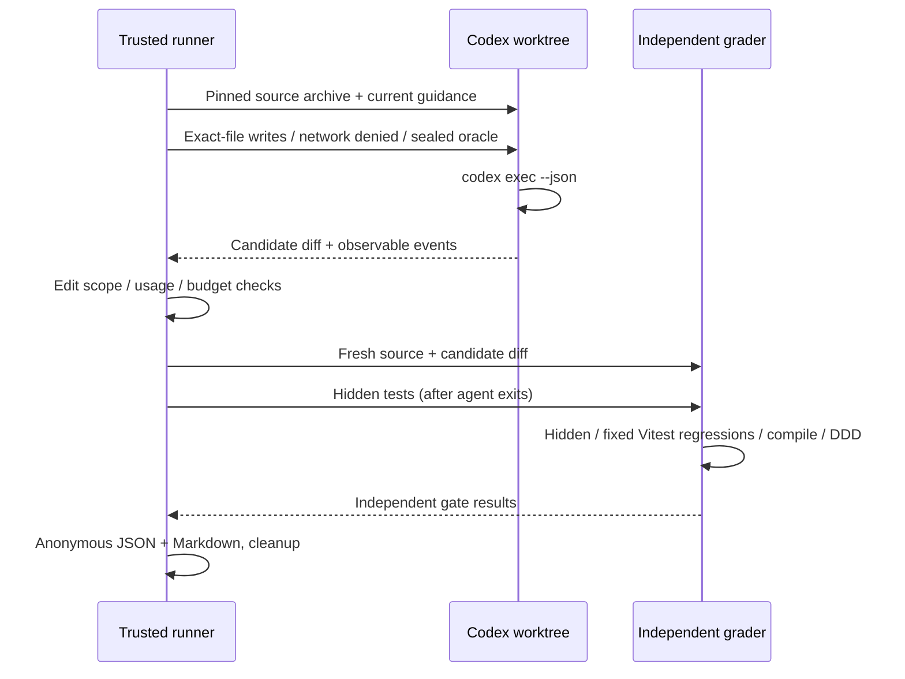

# Codex 実 Issue 評価

Issue #934 の評価は、過去の実 Issue を修正前の commit に戻し、Codex が実装した
差分を別 checkout で採点する。Waza の Skill 選択・guardrail 評価と、#932 の
Headroom 経路・cache 比較は、それぞれの既存コマンドで実行する。本 runner から
Waza や Headroom benchmark を起動しない。

## 固定した課題と採点

`evals/codex-issues/manifest.json` が開始 commit、課題文、編集可能なファイル、
hidden tests、既存回帰テスト、production-only reference patch の契約を持つ。
初期 pack は #675（既定言語）、#671（Ollama 接続先）、#717（描画回復）の3題。
各課題の対象と既存テストの選択理由は同ディレクトリの README に記録する。
実行開始時に guidance と oracle を private snapshot に固定する。現在の guidance
で削除した原本・Skill は過去 snapshot に残さず、seed の該当ディレクトリを置換する。

開始 commit の archive から新しい private Git repository を作り、その1 commit
を基に独立 worktree を作る。元 repository の object database、正解 commit、
reference patch、hidden tests は渡さない。アプリの code/dependencies は開始時点を
固定し、現在の AGENTS/APM/Skills をコピーして guidance の SHA-256 を記録する。
モデルと effort は明示した値を記録する。



合格には4つの採点 gate、許可範囲、正常終了、観測可能な使用量がすべて必要。
hidden と既存回帰の JSON report は固定した実 assertion 数と一致し、skip/pending
が0であることを要求する。grader の test/config/source は read-only とし、Vitest
の config を native loader で読み、cache/report は専用 scratch に置く。
エージェントの最終回答や「テストに成功した」という自己申告は採点に使わない。
baseline では修正前 hidden tests の実 assertion failure と、正解差分の4 gate
成功を検査する。import error、sandbox failure、skip は baseline 合格にならない。

## 実行

Node 24.x、Bun 1.3.14、全開始 commit を持つ Git checkout を使う。shallow clone
では履歴を取得してから実行する。実評価と baseline の OS sandbox は macOS の
Codex CLI 0.160 以降を使用し、利用できない環境では失敗として記録する。

```sh
bun install --frozen-lockfile
bun run agent:issues:check
bun run agent:issues:mock --output .codex-issue-results/mock
bun run agent:issues:pressure
bun run agent:issues:baseline --output .codex-issue-results/baseline
bun run agent:issues:real --run --model gpt-6.1-sol --effort high \
  --seconds 300 --tokens 500000 --output .codex-issue-results/real
```

`pressure` は synthetic データで権限を実測し、モデルを呼ばない。
実モデルを呼ぶ前に、同じ candidate 権限と同じ検査コマンドで固定した公開回帰
テストが実 assertion 数を満たすことも確認する。Vitest 一時認証ファイルは
trusted setup が生成し、テストと設定の書き込み権限は追加しない。
`--case default-language|ollama-host|render-recovery` で、失敗した題を別 directory
へ個別に再測定できる。自動 retry と区別し、最初の失敗 report を保存する。

`check` と `mock` はモデルを呼ばない。Mock の全体 status は `mock_passed` であり、
実モデル baseline の代わりに扱わない。通常 PR の workflow も static/Mock だけを
実行し、モデル credential を受け取らない。モデル・effort・APM・Skills・Hook・
runner の重要な変更時には、担当者がローカルで3題の `real --run` を実行し、
同一課題 pack の JSON を変更前と比較して PR に集計を添える。

`real` で `--run` がない、CI で実行する、定期モードで opt-in がない場合は
`skipped` と終了コード1を返す。credential 不足や基盤失敗も成功に変換しない。
今回の sandbox profile は Hook/MCP/Apps/browser/memory を無効にしている。
Hook 変更後の同じ profile の回帰計測は可能だが、Hook 自身の実行・効果はこの
計測から主張せず、既存の Hook/Waza 検査の証拠を併記する。

## 予算・認証・秘密保護

- 既存の ChatGPT subscription 認証のみ使用し、`CODEX_HOME` とホスト設定は変更
  しない。API key 環境変数を除去し、`forced_login_method=chatgpt` を固定する。
  API 従量課金への fallback は実装しない。利用枠不足は実評価失敗として扱う。
- 1題のモデル実行は既定300秒、指定可能10〜900秒。子プロセス group を停止し、
  TERM に応答しなければ KILL する。依存準備と各採点 command も180秒を上限にする。
- 1題の input+output token 上限は既定500,000。JSONL の完了 usage を使うため、
  provider の turn が返る前の厳密な token ceiling ではない。超過した題は不合格とし、
  次の題を起動しない。timeout、出力量超過、使用量欠落でも後続を止める。
  cache 入力も input に含む。大量の context を再送する課題は、明示的に上限を
  変更できる（最大2,000,000 token/題）。上限を変更した再測定は別 directory へ保存する。
- automatic retry は0。Codex 内部の retry event を記録する。再実行する場合は
  新しい output directory を使い、失敗した結果を上書きして消さない。
- subscription の題別金額は取得できないため `measuredCostUsd: null`。追加の API
  spend は許可・使用しない。subscription の利用枠を「無料」と表示しない。
- agent の write は列挙した regular files と `.agent-tmp` のみ。`.git`、`.codex`、
  oracle、grader、ホスト repository、auth storage を読めない権限を適用する。
  temp parent も deny し、private sibling にある答えへ到達できないことを実機で確認。
- agent と candidate code を実行する grader の network を禁止する。依存 install
  は修正前の固定 lockfile に対して trusted runner が事前に行う。
- raw prompt、最終回答、command output、tool payload、secret、ユーザー名、絶対
  path を公開 report に含めない。JSON/Markdown は case id、commit、設定 hash、
  status、時間、token/cache/tool/retry 集計、gate 成否だけを保存する。

## 定期実行は opt-in

自動 schedule は初期状態では作らない。利用者が明示的に希望した場合だけ、
ローカルの既存 scheduler から以下を呼ぶ。scheduler の全体 timeout と同時実行1を
設定し、subscription 利用枠を確認する。`weekly` は週ごとに固定 pack の1題を
巡回し、`monthly` はpack の3〜5題を実行する。

```sh
bun run agent:issues:real --run --cadence weekly --opt-in \
  --output .codex-issue-results/weekly-YYYY-MM-DD
bun run agent:issues:real --run --cadence monthly --opt-in \
  --output .codex-issue-results/monthly-YYYY-MM
```

## 運用・更新・rollback

pack の変更時は manifest と hidden tests/reference patch を review し、`baseline`
を3題以上で再実行する。開始 commit の問題が RED になることと、gold が hidden /
Vitest / compile / DDD に合格することを確認する。grader の緩和、しきい値低下、
skip の追加、正解の agent workspace へのコピーで評価を通さない。

`results.json` は schemaVersion=1。`results.md` は閲覧用の同じ集計。`failed` /
`baseline_failed` / `infrastructure_failed` / `agent_failed` / `scope_violation` /
`grading_failed` / `budget_exceeded` / `usage_unavailable` / `timeout` / `output_limit` /
`skipped` を合格と区別する。未取得の計測値を0で補完しない。

Codex の版と全 runner module の hash、30項目の実 sandbox pressure 結果も記録する。
認証・sandbox preflight の失敗は匿名の infrastructure_failed report として保存する。

通常の subprocess と同じ process group の子を TERM/KILL で停止する。独自に detach
した子の完全な終了まではこの macOS profile で保証しない。daemon を意図的に
作る adversarial 課題には外側の VM/container の lifecycle 制限を併用する。初期
課題の trusted setup/grading は daemon を必要としない。

各 run が作る private repository は finally で削除する。強制終了で残った
`tabbin-issue-eval-*` は実行中の PID と所有者を確認したうえでその directory だけ
削除する。ユーザーの元 checkout/worktree を stash/reset/remove しない。
output は Git ignore 対象で、公開する際は集計 JSON/Markdown のみを選ぶ。

rollback は変更前 runner と同じ manifest/configuration に戻して再計測する。
workflow を止める場合はこの static/Mock workflow だけを無効化し、Waza、Harness、
製品の品質・security gate は維持する。定期評価を止める場合は opt-in scheduler
を解除する。ホストの Codex 認証・provider を書き換える復旧操作は不要。

CLI と権限の契約は [Codex non-interactive mode](https://learn.chatgpt.com/docs/non-interactive-mode)
と [Configuration reference](https://learn.chatgpt.com/docs/config-file/config-reference) を参照。
JSONL usage と filesystem profile は、実際にインストールした CLI の pressure test
を併用して検証する。
