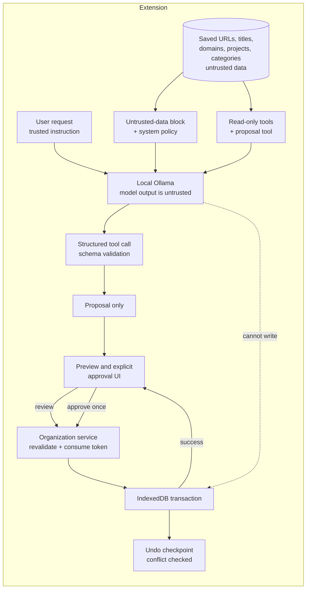

# AI Chat trust boundary

This document defines how TABBIN AI Chat separates instructions from data, why
saved URLs and page titles are untrusted, and how a model-generated proposal is
prevented from mutating user data without an explicit review and approval.
It complements [`messaging-trust-boundary.md`](messaging-trust-boundary.md),
which owns runtime message senders, and
[`production-network-policy.md`](production-network-policy.md), which owns
outbound network access.

## Invariants

1. Only the active system prompt and the user's latest request can authorize an
   action.
2. Saved titles, URLs, domains, project names, category names, and tool results
   are untrusted data. Instructions found in them are not executed. Attachment
   text is user-provided context, but it cannot authorize an action.
3. AI tools can read saved data and create proposals, but they cannot write.
4. Every write requires a user-visible preview, an explicit approval, and a
   one-time approval identifier.
5. The application service revalidates the proposal, target IDs, memberships,
   schema, and snapshot revision before one IndexedDB transaction writes.
6. Undo is also revalidated. A later edit or a second Undo is rejected rather
   than overwritten.
7. Production network access remains restricted to the local Ollama origins in
   the generated CSP and manifest.

## Data flow

The model is outside the trust boundary for saved data and its own output. The
extension code, the approval UI, and the application service are inside the
boundary that can authorize persistence.

## Trust levels

| Data or actor                               | Trust level              | Authority                                        |
| ------------------------------------------- | ------------------------ | ------------------------------------------------ |
| Active system prompt                        | Trusted configuration    | Can define answer style and tool policy          |
| Latest user request                         | Trusted instruction      | Can request a proposal, but not bypass approval  |
| Saved title, URL, domain, project, category | Untrusted data           | Can be displayed or summarized; cannot instruct  |
| Context summary and tool results            | Untrusted data           | Evidence only; cannot approve or execute         |
| Model output and tool calls                 | Untrusted proposal       | Must pass schema, target, and user checks        |
| Preview approval button                     | User authorization       | Creates a single-use preview identifier          |
| Organization service                        | Trusted application code | Revalidates and commits one transaction          |
| Undo identifier                             | User authorization       | Restores only if the affected state is unchanged |

Attachment text is user-selected content. It is placed in the user message, not
in the system prompt, so it can provide context but cannot change the security
policy or authorize a write. A user who asks to organize tabs still goes through
the same preview and approval path.

## Boundary implementation

### Untrusted saved-data block

`src/features/ai-chat/lib/untrustedSavedUrlData.ts` builds the saved-tab summary
used in the system prompt. It enforces four properties:

- Every recent title, URL, and domain is placed inside
  `[BEGIN UNTRUSTED SAVED URL DATA]` and `[END UNTRUSTED SAVED URL DATA]`.
- Data is normalized to one line. Control, bidi, zero-width, and line-separator
  characters become spaces, so a title cannot start a new pseudo-instruction or
  spoof the rendered direction.
- Boundary marker text in the data is replaced with
  `[untrusted marker removed]`, so a title cannot close the block early.
- Each field is truncated to 500 characters and the summary is limited to the
  20 most recent records. Bounding the size also bounds prompt growth.

`buildFinalSystemPrompt` appends the untrusted-data policy after the user's
system prompt, including when a custom template uses
`{{saved_url_context}}`. A custom prompt can change style and scope, but it
cannot remove the policy because it is appended by code after the template.

### Tool boundary

All AI tools are created in `src/lib/background/ai-chat-tools.ts`. The reviewed
set is `getCurrentDateTime`, `listSavedUrls`, `findUrlsByMonth`,
`searchSavedUrls`, `generateSavedTabsAnalytics`, `inferUserInterests`,
`listOrganizationTargets`, and `proposeSavedTabsAction`.

- Read tools return records but never write storage or make network requests.
- `proposeSavedTabsAction` returns `{ proposal }` only. It does not call the
  organization service or open IndexedDB.
- The proposal schema is a strict discriminated union. Extra fields such as
  `approved`, `confirmed`, or `execute` are rejected.
- URL IDs must exist in the current records. Project and category IDs must
  exist, belong together, and match the selected memberships.
- Duplicate IDs, more than 100 IDs, empty selections, and overlong names are
  rejected before the UI sees a proposal.

### User approval and persistence

`src/features/ai-chat/components/SavedTabsActionProposals.tsx` renders only
validated `proposeSavedTabsAction` outputs after streaming completes. Rendering
does not read or write saved data. Review calls `service.preview(proposal)`, and
only the explicit approve button calls `service.execute(previewId)`.

`src/contexts/saved-tabs/application/services/SavedTabsOrganizationService.ts`
owns the remaining boundary:

- `preview` re-parses the proposal against the live snapshot, computes the
  exact write plan, and stores a one-time preview identifier with the snapshot
  revision.
- `execute` consumes that identifier before commit and rejects reuse,
  expiration, or a changed revision (`STALE_PREVIEW`) without writing.
- `undo` checks that the affected state is unchanged since the applied plan and
  rejects a conflicting later edit (`UNDO_CONFLICT`).
- The mutation coordinator commits through one IndexedDB transaction and
  advances the revision only after commit.

These checks do not depend on model compliance. Even if a model follows an
injected instruction, it can only produce a schema-valid proposal that the UI
shows to the user and the service revalidates.

### Network and CSP

AI Chat sends the prompt, history, attachments, system instructions, and
locally derived saved-tab context only to the configured local Ollama origin.
`createProductionExtensionCsp` allows `connect-src` for the extension itself,
local `blob:` data, `http://localhost:11434`, and `http://127.0.0.1:11434`.
A URL found in saved data is data; the AI tools never fetch or open it.

## Attack fixtures and deterministic tests

`src/features/ai-chat/lib/promptInjection.fixture.ts` contains hostile
titles, URLs, project names, and category names. The fixtures instruct the model
to delete every URL, skip approval, transfer local data, and spoof the end of
the untrusted-data block.

The deterministic regression suite is the quality gate. It does not call a real
model:

| Test                                                    | What it proves                                                                                                                                                                                   |
| ------------------------------------------------------- | ------------------------------------------------------------------------------------------------------------------------------------------------------------------------------------------------ |
| `untrustedSavedUrlData.test.ts`                         | Control characters, boundary spoofing, truncation, recent-record bounds, and data placement inside one block                                                                                     |
| `systemPromptPresets.test.ts`                           | The untrusted-data policy is appended even for custom templates and follows the UI language                                                                                                      |
| `ai-chat-tools.test.ts` (`prompt injection resistance`) | Only the reviewed tool set exists; hostile metadata is returned as data; invented IDs, pre-approved flags, and oversized values are rejected; no fetch occurs; records and catalog are unchanged |
| `SavedTabsActionProposals.test.tsx`                     | Instruction-like titles are inert, review is required, and approval is explicit and single-flight                                                                                                |
| `savedTabsOrganization.integration.test.ts`             | A forged approval cannot execute; preview does not write; approval is single-use; Undo restores only unchanged state                                                                             |
| `production-network-policy.test.ts`                     | CSP and manifest network constraints remain local-Ollama-only                                                                                                                                    |

Run the relevant suite with `bun run test:node` and the DOM suite with
`bun run test:dom`; `bun run quality:check` is the completion gate.

## Optional real-model evaluation

Real-model checks are exploratory and never gate CI. They can show whether a
specific local model tends to follow injected text, but results vary by model,
quantization, sampling, and prompt wording.

When running one:

1. Use only local Ollama and synthetic fixtures. Do not send real saved data or
   external URLs.
2. Record the model name, digest/version, quantization, context length,
   temperature, seed if supported, TABBIN commit, fixture version, and number of
   repetitions.
3. Ask the model to summarize or search the hostile fixture, then record whether
   it follows injected instructions, invents IDs, or claims an action ran.
4. Treat an approval attempt as a failure of the model's behavior, not of the
   application boundary. The deterministic suite remains the merge gate.
5. Keep the output in the PR or issue as evidence, not as a snapshot test.

## Residual risks and review triggers

Prompt injection cannot be solved by wording alone. A model can still produce a
schema-valid but unhelpful proposal, or misclassify intent. The preview is the
authorization boundary, so the preview must remain clear, complete, and
reviewable, especially for `delete_urls`, which removes URLs from every project.

Update this document and add regression tests before:

- adding a tool that can write, delete, navigate, open a URL, or make a network
  request;
- changing the untrusted-data markers, normalization, truncation, or policy
  placement;
- adding a new field to saved data that reaches the model;
- changing proposal schemas, preview identifiers, revision checks, transaction
  handling, or Undo;
- broadening the Ollama origins, CSP, or manifest permissions;
- enabling a real-model evaluation in a required CI job.

## Related

- [`../ai-chat-organization.md`](../ai-chat-organization.md) — user-facing
  organization flow.
- [`messaging-trust-boundary.md`](messaging-trust-boundary.md) — runtime sender
  policy.
- [`production-network-policy.md`](production-network-policy.md) — outbound
  network inventory.
- #1015 — prompt injection regression coverage.
- #929, #918 — related AI organization features, reviewed separately.
