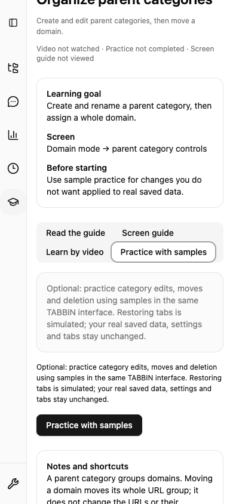

# Academy 統合品質ゲート

Issue #1004。既存の章別 unit / E2E を使い、教材と実装の参照、
本番データの不変性、Chrome / Firefox の配布判定をまとめます。

## 通常 PR とリリース

| 検査                                                                                                      | 通常 PR                                                                       | リリース / 手動 / 毎週                                        |
| --------------------------------------------------------------------------------------------------------- | ----------------------------------------------------------------------------- | ------------------------------------------------------------- |
| `bun run academy:check`                                                                                   | catalog・scenario・日英タイトル/手順・step・実 JSX target・素材hash/VTTを検査 | 同じ検査                                                      |
| `bun run academy:e2e`                                                                                     | Chromiumで全章の日英・動画・操作練習・axe・キーボード・中断/再開/復習         | `release:e2e` でも必須                                        |
| `bun run academy:check .output/chrome-mv3 .output/firefox-mv2 .output/*-chrome.zip .output/*-firefox.zip` | 既存 Verify Build job の配布物に対して欠損/改変・撮影fixture漏出を検査        | `release:check` は両ディレクトリ、`release:zip` はZIPも必須   |
| Firefox native Academy smoke                                                                              | 通常PRで再収録やnative環境導入を強制しない                                    | Academy Quality workflowの手動/毎週、および既存 `release:e2e` |
| `size:loads` / `size:report`                                                                              | 既存Verify Build jobで初回feature別JSとZIPを計測                              | base branchとの比較をPRへ記録                                 |
| `perf:budget`                                                                                             | 既存 Saved Tabs budget を維持                                                 | 同じ指標としきい値を使用                                      |

`academy:check` はTypeScript native parserのNode実行要件に合わせて一時的な
Node bundleを `.output/` に作ります。FFmpeg/撮影/再レンダリングは起動しません。
制作依存・権限・CDNを本番へ追加しません。元のquality/coverage/release gateを維持します。

```sh
bun run quality:check
bun run test:coverage
bun run academy:check
bun run academy:e2e --list
bun run academy:e2e
# Native Firefox/driverを先に準備し、両環境変数を指定する。
bun run verify:firefox-smoke-environment
FIREFOX_EXTENSION_SMOKE=1 bun run test:firefox:smoke e2e/firefox.extension.academy.spec.ts --list
FIREFOX_EXTENSION_SMOKE=1 bun run test:firefox:smoke e2e/firefox.extension.academy.spec.ts
bun run release:check
bun run release:zip
```

不足binary・起動失敗・未完了gateは不合格として扱います。Firefoxの通常skipは
リリース成功の証拠になりません。手動/毎週workflowは `FIREFOX_EXTENSION_SMOKE=1`
を設定してnative proofを必須assertします。

## 検証する契約

- 全8章で、日英の直リンク、明示的開始、離脱後の続きから、スキップとリロード、
  最初から見直す、動画モード、任意の練習導線/非対応説明を確認します。
  スキップと動画・操作達成は独立した事実で、復習しても達成を捏造しません。
- 既存 `academy-progress` は同じprofileの再起動と同時更新、unitはversion移行・
  二重イベント・resetを検査します。native保存の解説は架空の練習targetを持たず、
  動画で評価します。動画/assessment versionは維持し、旧token・視聴・スキップを
  消さず、続けて動画を記録できます。
- read-only Joyrideは本番UIと既存データで開始します。0件・動的target消失では
  案内/テキストへ戻れ、サンプルを自動投入しません。Focus/ARIA/Escape/前後/Modalを検査します。
- 書込練習は最小6 URL / 3 domainのin-memory compositionを使います。
  削除・作成・移動・並べ替え・模擬復元・reset・reload・離脱前後で、実IndexedDB、
  進捗以外のstorage、実タブIDを比較し、native tabs.create/remove/update等の試行をguardします。
  通常アプリの設定移行を完了してからbeforeを採取します。30サイト40タブは不要です。
- 日英16 MP4を実decodeし、poster、手動再生、pause/seek/速度、日英字幕/OFFを検査します。
  素材は拡張同梱で、Academy一覧/テキストでは動画・VTTを要求しません。
  MP4が現在の公開形式です。WebMを追加する場合はcatalog・検査も同時更新します。
- WCAG A/AAのaxeを無効化せず、390px・日英・明暗・reduced motion・キーボードを検査します。
  Chromeのnative導入/固定映像とFirefoxの手順差はテキストとplayer内に明示します。

## 人によるリリース判定

自動検査のgreenは映像内容の承認を意味しません。教材更新時は
[制作/失敗take/last-goodの運用](../../tools/academy/pipeline/README.md)、
[8章と既存の視覚確認記録](../../tools/academy/scenarios/README.md)、
[技術結果と視覚レビュー](../../tools/academy/content-result.json)を対応付けて確認します。
実録画を概念映像で置換した場合は明示し、個人情報・実在URL・認証情報の混入を目視確認します。

リリース担当者は次をPR/リリース記録に残します。

1. commit、browser/runtime版、成功/失敗したcommand、trace/screenshot/動画結果の場所。
2. 日英字幕の読みやすさ、映像/手順の対応、Chrome/Firefoxの差、音声がない旨の説明。
3. Tab/Shift+Tab、Enter、Escape、guide前後/キャンセル、focus復帰、390pxスクロールの実画面確認。
4. 同一環境・同一build条件のbase/headで、初回feature JS・共有JS・全ZIP・Academy素材総量を比較。
5. 自動チェック・人の内容承認・配布判断を分け、未確認項目は未確認と記録。

重い再制作やストアGUI収録は通常PRで行いません。素材変更時に制作workflowを実行し、
失敗takeを保持、目視確認を経てlast-goodを更新します。毎週のFirefox失敗では
browser/runtime更新・codec・対象DOM・字幕を切り分け、テストをskipして解決しません。

## Issue #1004 の測定記録

[base/headの実測値](academy-quality-comparison.json)は同じ依存・build条件で比較しました。
Chrome/Firefoxとも全ZIPは +100 B、初回のsaved-tabs/options/ai-chat/analytics JSは
増加0 Bです。Academy静的素材は6,246,409 B。素材は変更していません。
測定のFirefox起動では、macOSの実アプリデータ領域保護による終了を再現し、
既存native smokeと同じCocoa領域分離をinitial-load helperにも適用しました。


