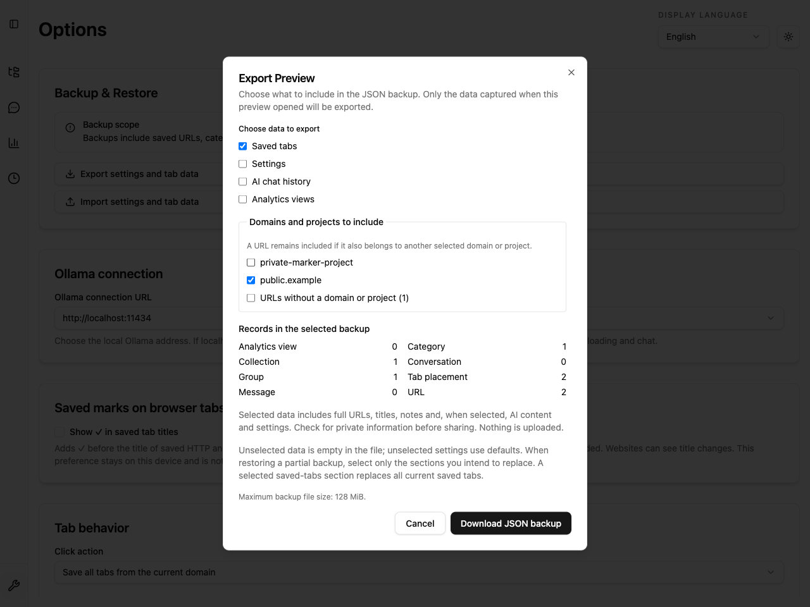
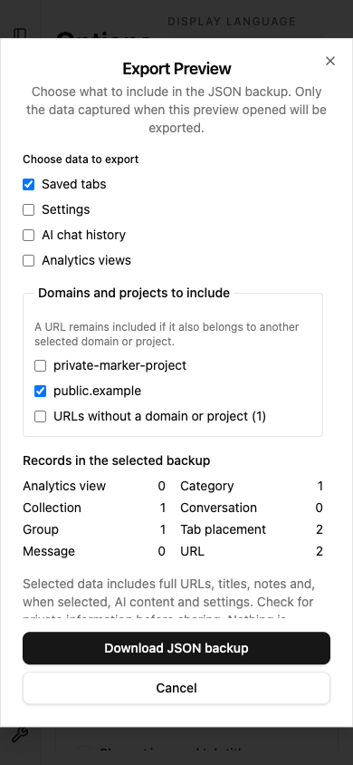

# JSON バックアップの対象選択（Issue #928）

設定画面のエクスポートを押すと、ファイル作成前に対象と件数を確認できる。
保存タブ・設定・AI チャット履歴・分析ビューはすべて未選択で開始し、
選択後に「JSON バックアップをダウンロード」を押すと書き出す。
Markdown / HTML / CSV 共有はこの変更の対象外。



## 選択とプライバシー

- 保存タブはドメイン／プロジェクト単位で除外できる。どちらにも所属しない URL も
  独立して選択できる。一覧は20件ずつ表示し、別ページの選択も維持する。
- コレクションを除外すると、そのカテゴリ・配置・メモと、選択先から参照されない URL・
  グループを除外する。同じ URL が別の選択先にもある場合、その URL 自体は残る。
- URL・タイトル・保存日時・お気に入りなど、復元に必要な項目を保つ。
  選択したデータに含まれる URL の機密性を自動判定・匿名化する機能ではない。
- 設定を除外した場合は個人設定を引き継がず、既定値を出力する。AI 履歴を除外すると
  会話とメッセージの両方を出力しない。外部へのアップロードや権限追加はない。
- 開いた時点の一貫した IndexedDB スナップショットを確認し、同じ内容を出力する。
  確認後の保存・編集は混入しない。最新データを使う場合は閉じて開き直す。
  設定は既存の別ストレージから読み取り、IndexedDB との同時トランザクションは保証しない。
- キャンセル時はファイルを作らない。閉じた後の読み込み結果は破棄し、再度開いたときは
  選択をリセットする。書き出し失敗時は確認内容を保持して再試行できる。

## 互換性と部分復元

既存の厳密な Backup V2 JSON 形式とサイズ・リソース上限を維持する。
全区分・全コレクション・未所属 URL を選択すれば、従来と同じ完全バックアップになる。
DB、バックアップ schema、ブラウザ権限の移行は不要。

部分バックアップでは、除外した区分は空データ、設定は既定値として保存される。
復元時も置き換える区分だけを選択すること。保存タブを復元すると現在の保存タブ全体が
置き換わるため、特定コレクションだけを既存データへ追加する用途には使わない。
この注意は書き出し確認画面にも表示する。

## 検証

`BackupV2ExportSelection.test.ts` は依存レコード・共有 URL・メモ・未所属 URL・
区分ごとの除外、完全バックアップとの同値性、入力不変、件数一致を検証する。
`ExportBackupDialog.test.tsx` と `ImportExportSettings.test.tsx` は確認前の
ダウンロード禁止、非同期読み込みの競合、キャンセル、再試行、連打、ページ送りを検証する。

```sh
bun run e2e --project=extension --grep=backup-export-preview --workers=1
```

この E2E は実拡張で秘密情報を模したデータの除外、表示件数とダウンロード内容の一致、
保存データの不変性、既存インポート画面での復元を確認する。
通常実行の画像は `testInfo.outputPath()` 配下に保存する。
この文書の追跡画像は検証時の画像を明示的にコピーして更新する。


