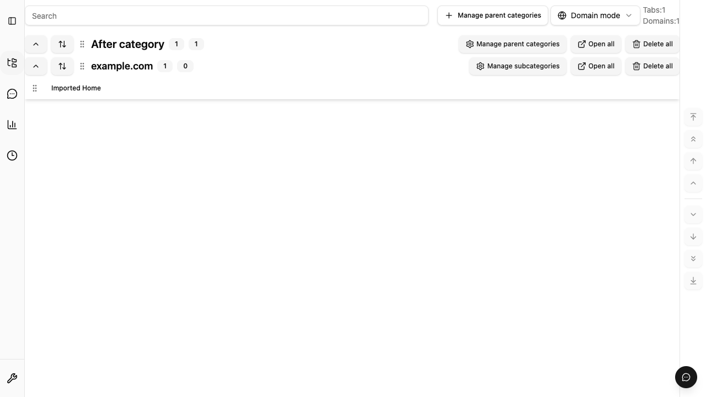

# Cross-context invalidation regression checks

The [persistence change protocol](../architecture/persistence-change-invalidation.md)
keeps IndexedDB authoritative. Change messages contain only `changeId`,
`revision`, and `scopes`; consumers re-query current data.

Issue #902 exposed two gaps on the implementation inherited from #739 and
#885: successful Backup V2 import did not publish its final revision, and open
Saved Tabs pages did not repair missed notifications on focus. URL-only refresh
also left imported category and project metadata stale.

The import now publishes after replacement, settings write, and verified
readback. Notification failure is a typed partial success and does not restore
or repeat the committed import. Saved Tabs subscribes and repairs after its
initial load, coalesces pending changes by key, serializes refreshes, and repairs
on focus or becoming visible. The in-flight drain is shared across effect
cleanup/setup so port/readiness changes and StrictMode replay also retain read
ordering. Settings continue through their existing storage
boundary. These changes require no schema migration or new extension permission.

## Browser checks

```sh
bunx playwright test e2e/cross-context-sync.extension.spec.ts e2e/persistence-worker-restart.extension.spec.ts --project=extension --workers=1
bun run e2e --project=extension --workers=1
bunx playwright test --config playwright.indexeddb.config.ts
bun run test:firefox:indexeddb-smoke
```

The Chrome extension tests exercise the actual toolbar save, background delete,
Options import, open domain/custom views, category/project metadata, and a real
MV3 worker restart without reloading the observer pages. They also check that
notifications carry no titles or URLs and duplicate delivery does not mutate the
committed snapshot.

The delivery test holds native BroadcastChannel callbacks only in the consumer.
It waits for the exact URL-scoped delete and import revisions before releasing
both in reverse order twice. A recovery-snapshot-only hint cannot satisfy this
barrier. The missed-event case keeps the callback held while focus repairs from
IndexedDB; no polling fallback is added to the application.

The native browser suite also mounts the production React synchronization hook,
BroadcastChannel adapter, consistent reader, and actual save/delete/Backup V2
import use cases in two consumer pages. Chromium and Firefox both verify normal
delivery, missed-event repair, exact-revision reverse/duplicate delivery, unchanged
canonical data after replay, and unchanged page load IDs.

The same extension UI scenarios are registered for Firefox:

```sh
bun run build:firefox
FIREFOX_EXTENSION_SMOKE=1 bunx playwright test --config playwright.firefox.config.ts e2e/firefox.extension.cross-context-sync.spec.ts
```

Run them only with a Firefox build/profile that supports extension loading and
extension-page automation. A disabled smoke or an unsupported browser is not a
pass. Native IndexedDB/browser tests and the geckodriver temporary-addon smoke
provide separate evidence and must not be reported as full Firefox UI coverage.

## Import result in the open Saved Tabs page

The screenshot uses only the synthetic regression fixture. The existing page
shows the imported URL and renamed parent category without a reload.


