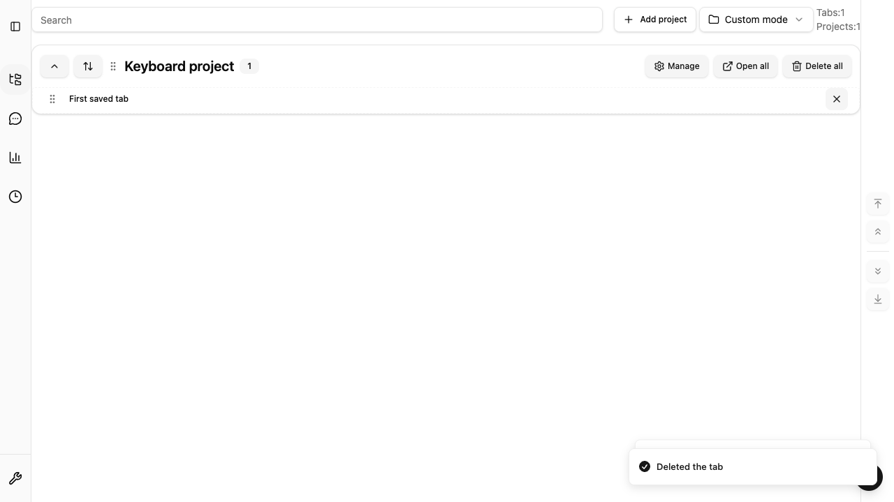

# Saved Tabs の reduced motion

Issue #896。OS の `prefers-reduced-motion: reduce` に合わせ、既存の表示状態と保存操作を保ったまま動きを抑制します。アプリ独自の設定や永続データは追加しません。

## 対象と既存契約

| 操作                                             | 動きを減らす設定                                                  | 件数・状態・失敗時の表示                                                                |
| ------------------------------------------------ | ----------------------------------------------------------------- | --------------------------------------------------------------------------------------- |
| Domain / Custom の URL・カテゴリ・カード並び替え | CSS transition と delay を短縮。ドラッグ位置の transform は保持   | #895 の項目名・位置・全件数・確定/取消のライブ通知を維持。保存成功/失敗は既存処理が通知 |
| 画面外へのキーボード並び替え                     | 5 か所の KeyboardSensor で instant scroll を使用                  | 既存の座標計算・移動先・取消とフォーカス復帰を維持                                      |
| Custom の drag overlay                           | drop の Web Animations API とキーボード移動の transition を無効化 | ドラッグ中の項目名とドロップ候補を保持                                                  |
| ダイアログ・メニュー・カード開閉                 | 既存 Tailwind/Radix のアニメーションを短縮                        | 開閉結果、URL 件数は静的に表示                                                          |
| 上下端・相対ターゲットへのスクロール             | 呼出時に OS 設定を確認して instant を使用                         | 既存ライブ通知と到達先の静的な枠表示を維持                                              |
| toast・読み込み                                  | Sonner の既存 reduce 対応を利用。CSS spinner も短縮               | 成功/エラー文、Undo ボタン、読み込みの role/label を保持                                |

表示中に OS 設定を変更した場合も CSS と overlay が追従します。スクロールは操作ごとに現在の設定を確認します。通常設定の drop animation は既定の 250ms を維持します。

## 回帰検証

- `useSavedTabsSensors.test.tsx`: 通常/reduce と設定切替で座標計算・pointer sensor を保持。
- `src/hooks/useReducedMotion.test.tsx`: OS 設定の切替と購読解除、media query がない環境。
- `scroll-controls.test.ts` / `SavedTabsScrollControls.test.tsx`: 相対移動と上下端での instant scroll、設定の切替、ライブ通知。
- `e2e/reduced-motion.extension.spec.ts`: Chrome/Firefox で本番 CSS の inline style への優先、delay の消去、transform/到達先表示の保持。Chrome 拡張で通常/reduce の drop animation、キーボード取消・確定・再読込後の IndexedDB 順序、Radix 開閉・件数・toast 表示。30件のURLを画面外へキーボード移動し、scrollTo/scrollByにsmooth指定がないことも確認。

```sh
bunx playwright test e2e/reduced-motion.extension.spec.ts --project=extension --workers=1
bun run e2e --project=extension --workers=1
bun run quality:check
bun run test:coverage
```

Firefox 155.0 の実拡張でも OS 設定を reduce にして、Domain/Custom URL、親子カテゴリ、プロジェクト間移動の6経路を確認しました。取消・保存後の再読み込み・notes の維持に加え、drop 時の Web Animations API 呼出しがないことを確認しています。

確認用データは専用のブラウザプロファイルに作成します。既存データの schema、保存順序、snapshot/Undo、ブラウザ権限は変更しません。



単一削除後の Undo 到達性・復元の監査は [Issue #922](https://github.com/haruto-yamada1/TABBIN/issues/922) の範囲です。今回の追加確認では通常設定でも復元後の表示が空になるケースを確認したため、動き抑制の修正に含めていません。
