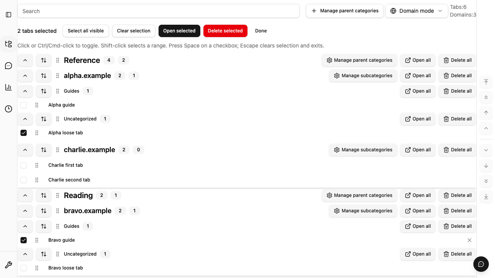

# 保存したタブの複数選択

Domain モードで「タブを選択」を押すと、展開中の一覧にチェックボックスを表示します。
通常時のリンククリックや Ctrl/Cmd クリックの動作は維持します。

- 選択中のクリック、Ctrl/Cmd クリック、チェックボックスの Space は選択を切り替えます。
- Shift クリックは、最後に切り替えた項目から実際の表示順で範囲を選択します。
  親カテゴリ、ドメイン、子カテゴリをまたいで使えます。
- 「表示中をすべて選択」は、展開して表示している項目だけを対象にします。
  折りたたみで隠れた項目は選択から外れ、検索変更でも選択を解除します。
- 「選択を解除」は選択だけを消し、「選択を終了」または Escape は選択モードを終了します。

選択したタブのオープンは既存の一括オープン処理を使います。10 件以上は件数を示して確認し、
進捗、キャンセル、失敗した URL の再試行は既存の結果表示から操作できます。

選択削除は `confirmDeleteAll` 設定に従って確認します。確定した対象を一括検証し、
複数ドメインを 1 回の revision 付き IndexedDB transaction で更新します。
途中で失敗した場合は全体を保存せず、選択を残して再操作できるようにします。
従来の Domain 削除と同様に、同じ URL の Custom 登録も削除します。
成功時は、同じ transaction の更新前 snapshot を使って一度の Undo で双方を復元できます。
一覧の再読み込みだけが失敗した場合は、削除の成功と区別して案内します。

選択自体は画面内の一時状態で、保存形式や拡張機能の権限は変えません。
Custom への一括追加は Issue #283 の対象です。

## 検証

- `SavedTabsSelectionProvider.test.tsx`: 表示順、逆方向の範囲選択、キーボード、解除、
  検索・折りたたみ、処理中の二重操作防止、確認、失敗時の選択維持。
- `DeleteSelectedSavedUrlsUseCase.test.ts` と native integration:
  対象の所属検証、重複除去、単一 commit、途中失敗の rollback、カテゴリ・Custom への反映、
  Undo 後の close/reopen と手動順序。
- `selection.extension.spec.ts` と `firefox.extension.selection.spec.ts`:
  複数ドメインの範囲選択、選択対象だけの削除、Undo、検索・折りたたみ、一括オープン。

通常の Firefox Playwright fixture で一時拡張の識別子を取得できない環境では、
`GECKODRIVER_PATH` と `FIREFOX_EXECUTABLE_PATH` を指定し、
`python3 docs/testing/reproduce-firefox-selection.py --run` で同じ seed を使った
実際の UI 操作・IndexedDB・Undo を検証できます。先に `bun run build:firefox` を実行してください。

