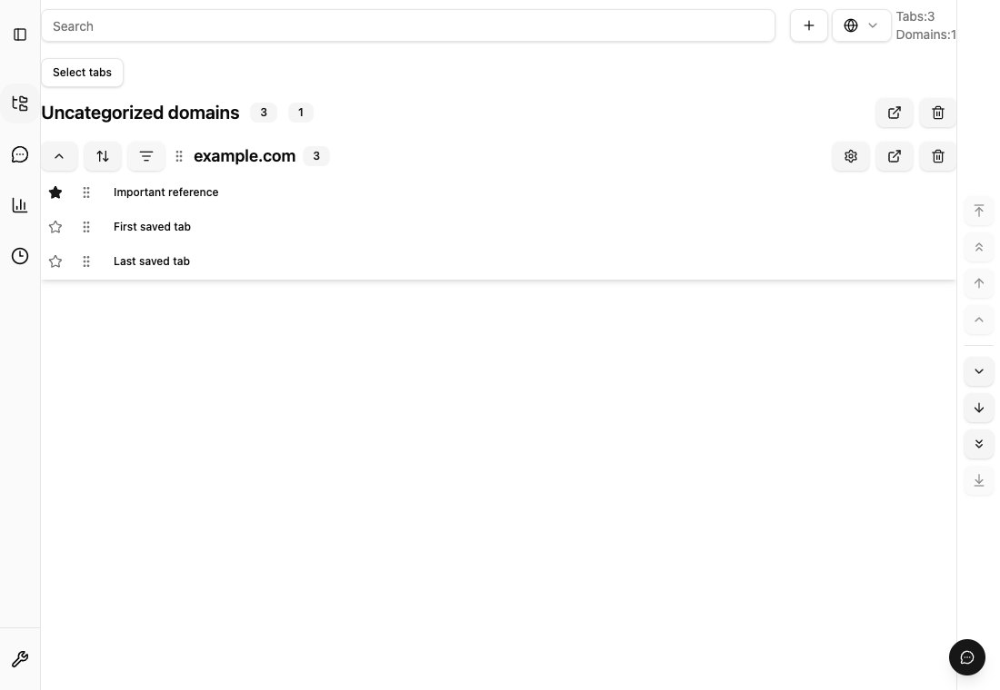

# 保存URLのお気に入り（Issue #912）

行の星ボタンで保存URLをお気に入りにする。お気に入りはカテゴリ内の先頭に表示し、
同じURLを参照する Domain / Custom の両モード、開いている別ページにも反映する。
カードのフィルタでお気に入りだけを表示できる。フィルタの状態はそのカードを開いて
いる間だけ保持し、一括操作は表示中のURLに限定する。



## 保存・削除の契約

- IndexedDB の正規 `urls` レコードに optional boolean `isFavorite` を保存する。
  古いレコード・Backup V2 では省略を false として扱う。新規 index、DB version、
  userSettings、ブラウザ権限は追加しない。
- URL ID ごとの共有属性であり、コレクション移動、再保存、Undo、Backup V2 の
  export/import、readback 検証でも保持する。不正な型は decoder / import で拒否する。
- 期間による自動削除はお気に入りの Domain membership を除外する。
  Custom membership の期限処理は従来どおりで、この機能で新しく自動削除しない。
- 星を外しても保存日時は変わらない。すでに期限切れなら次回の期限チェックで対象に
  戻る。明示的な削除、開いた後・外部ドロップ後の削除は既存設定に従う。
- ブラウザの pinned タブを保存対象から除外する設定とは独立している。
- 表示優先度は投影だけに適用し、membership の手動順序を書き換えない。日時順では
  お気に入り内とその他それぞれに日時順を適用する。固定表示・絞り込み中はURLの
  手動並び替えを無効にする。星を外してフィルタを解除すると元の順序に戻る。
- Analytics はお気に入りを含む全URLを従来と同じ単位で数える。お気に入り操作は
  保存イベントや保存日時を変更しない。整理候補と明示的な削除は引き続き利用できる。

## 検証

`bun run test:node`、`bun run test:dom`、`bun run test:coverage`、
`bun run quality:check` が通常のゲート。個別のブラウザ回帰は次で実行できる。

```sh
bunx playwright test e2e/favorite-urls.extension.spec.ts --project=extension --workers=1
```

通常実行のスクリーンショットは Playwright のテスト出力ディレクトリに保存する。
ドキュメント用の追跡画像を更新するときだけ、次を明示的に実行し、画像差分を確認する。

```sh
UPDATE_DOC_ASSETS=1 bunx playwright test e2e/favorite-urls.extension.spec.ts --project=extension --workers=1
```

この回帰は実際のIndexedDBと拡張UIで、星の同期、再読み込み、固定表示、
空のフィルタで隠れたURLを削除しないこと、Backup V2 往復、background の
期限チェック、星の解除後の期限処理を確認する。unit/integration は拒否された
書き込みの無変更、再接続、Undo、再保存、型の拒否、Analyticsの同値性も検証する。

## 互換性・ロールバック

既存データの一括 migration は不要。古いBackup V2を新しい実装で読み込める。
新属性を含むBackup V2は旧版の厳密schemaでは拒否され得るため、新しい実装で復元する。
お気に入りに未対応の旧版へ戻す場合は、自動削除を無効にしてから戻す。
お気に入り保護は対応版のbackgroundの期限チェックが実行して初めて成立する。
