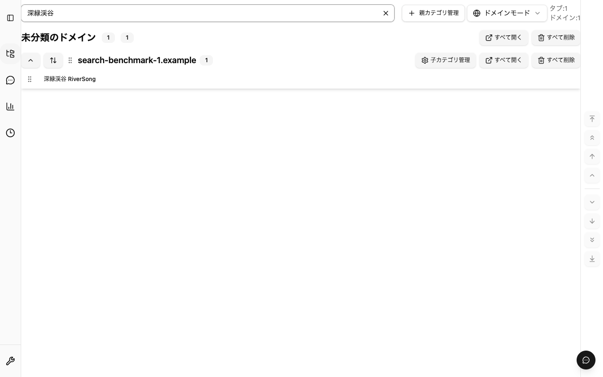

# Saved Tabs search performance (#900)

## Baseline and scope

The baseline is `develop` at `a24f1390d7d6c9fd038ca23057a2666e3439d7df`.
The live issue has no comments or additional requirements. Completed #26 and
#149 establish search and filtered result counts. #901 / PR #968 already
optimizes the verified IndexedDB read projection and per-call URL joins;
this benchmark measures actual UI input, which that read audit does not time.

Domain search filters loaded data with case-insensitive substring matching for
title, URL, domain, parent category and subcategory. Custom search uses Fuse
with threshold 0.4 for project names and URL titles/addresses. A project-name
match retains all its memberships. These matching rules remain unchanged.

## Reproduction and measurement

Use the Node/Bun versions in `.node-version` / `.bun-version`, frozen dependencies,
and installed Playwright Chromium and Firefox. Run the browsers sequentially,
without concurrent build/test gates:

```sh
bun run e2e --project=extension --workers=1 --grep 'search latency' --reporter=line
bun run build:firefox
FIREFOX_EXTENSION_SMOKE=1 bun run test:firefox:smoke --grep 'search latency'
```

Both browser wrappers call `e2e/helpers/search-performance.ts` against the
production extension page with native IndexedDB. Each test uses 1,000 or
10,000 unique synthetic URLs, 20 domain collections, 5 custom projects and
2U memberships (one domain and one custom membership per URL). A Japanese
parent category owns one domain. All addresses use reserved `.example` names.
No actual saved data or network requests are needed.

Twelve trusted input events replace the query with alternating Japanese titles
that yield different one-row results. Each latency starts at the document's
capture-phase input listener using page-local `performance.now()`, excluding
Playwright RPC time. The probe records:

- Input to a double-`requestAnimationFrame` paint opportunity.
- Input to the exact expected result URL set in the DOM, following a mutation,
  and to a subsequent paint opportunity.
- Page-local readonly IndexedDB transactions and elapsed time until no reads
  remain active and two animation frames introduce no new reads after results.
- Observed body mutation records. These count DOM changes, not React renders.

Initial full-list hydration and clear-to-full-list correctness are outside the
timed scenario. The benchmark also checks Japanese text, partial title matching,
case folding, Domain parent-category matching, clearing and the final result
after rapid edits. Aggregate JSON is saved in each test's `test-results` directory
and attached to its report.

Measurements are observations, not absolute CI performance thresholds. A double
animation frame indicates an opportunity to paint, not physical presentation.
Input capture excludes delay before dispatch; this is not a complete INP
measurement. Broad result rendering, startup, heap retention and Japanese IME
composition are outside the timing claim. Pending warm-up work and OS scheduling
can affect tails; transaction counts and regression assertions provide the
deterministic evidence.

## Findings and change

`SavedTabsApp` ran Custom filtering for the current query even while Domain mode
was visible. Every nonempty edit resolved URL records for unmatched custom
projects, rebuilt Fuse indices and updated a hidden projection. A regression
test reproduces 28 additional repository reads when typing `docker-cmd` in Domain
mode (3 reads before typing, 31 after).

The active view determines whether Custom filtering receives the query. Domain
keeps its current input and uses its existing loaded-data search; switching to
Custom applies that input through fresh URL reads. The change introduces no
retained query cache, debounce interval, database index, storage schema change,
permission or network capability. Existing invalidation and persistence operation
boundaries remain authoritative.

The matching policy is not changed to obtain faster timings. Custom result
completion includes verified per-project reads and remains distinct from input
responsiveness. A retained cross-query index would need an explicit freshness
contract; it is not required to remove the measured hidden-mode work.

## Browser observations

[Aggregate results](search-performance-results.json) retain p50/p95/max, counts
and limitations. Measurements on 2026-10-19 used macOS arm64, Bun 1.3.14,
Playwright 1.63.0, Chromium 153.0.8010.12 and Firefox 155.0. Chromium orchestration
used Node 24.17.0; the native Firefox runner used Bun. Browsers ran sequentially,
without concurrent test/build gates. Values below are medians of 12 inputs in ms.

| Browser  | Mode   |   URLs | Next paint opportunity before → after | Result DOM before → after | Read work settled before → after | Readonly transactions before → after |
| -------- | ------ | -----: | ------------------------------------: | ------------------------: | -------------------------------: | -----------------------------------: |
| Chromium | Domain |  1,000 |                           25.4 → 25.8 |                 8.3 → 4.5 |                       136 → 58.7 |                                6 → 1 |
| Chromium | Domain | 10,000 |                           31.7 → 19.6 |               25.9 → 16.8 |                   1407.3 → 204.9 |                                6 → 1 |
| Chromium | Custom |  1,000 |                           25.3 → 23.8 |             156.5 → 132.6 |                      209.5 → 175 |                                7 → 6 |
| Chromium | Custom | 10,000 |                           26.2 → 24.9 |           1524.1 → 1380.9 |                  1570.8 → 1417.6 |                                7 → 6 |
| Firefox  | Domain |  1,000 |                               15 → 17 |                     6 → 8 |                          96 → 52 |                                6 → 1 |
| Firefox  | Domain | 10,000 |                               30 → 13 |                   14 → 10 |                        811 → 130 |                                6 → 1 |
| Firefox  | Custom |  1,000 |                                 7 → 7 |                   99 → 85 |                        140 → 136 |                                7 → 6 |
| Firefox  | Custom | 10,000 |                               18 → 26 |                 975 → 842 |                       1016 → 882 |                                7 → 6 |

The measured improvement removes five hidden Custom project reads from Domain
search. One page-local readonly transaction remains; no zero-read claim is made.
Custom retains verified source reads. Its pending-result generation guard also
avoids obsolete project-card work: observed readonly transaction medians change
from seven to six. Input paint opportunity medians stay below 33 ms in these
scenarios. No broad-result, cold-start, general device budget or physical paint
guarantee follows from this.
The 12-sample p95 is the maximum, so tails should not be treated as a stable
population estimate.

The current macOS Playwright Firefox fixture cannot discover the unsigned
profile-copied add-on. Its four setup failures are not reported as search passes.
Native Firefox evidence instead used geckodriver 0.37.1, a temporary XPI with the
production background retained, and the lifecycle helpers from
`tools/scripts/firefox-persistence-indexeddb-smoke.ts`. The same synthetic seed
and page measurement probe were reused. Both before/after runs passed all four
size/mode cases, including exact result sets, case-insensitive partial titles,
Japanese queries, Domain parent categories, clearing to U rows and latest-query
results after successive edits. Mozilla's downloaded macOS ARM64 driver archive
matched its published SHA-256
`d02b3f7003f999caf90974a2ef5da0286c05d01cee19112c86846d759fdba4f5`.

Native input selected the previous query with Meta+A and typed one Japanese
character matching each title. The Chromium wrapper replaces the four-character
Japanese title with Playwright `fill`. Native Firefox reused a fresh profile
across reseeded cases; Chromium creates a fresh profile for each case. Compare
before/after within a browser; these transport and query differences prohibit a
browser-versus-browser speed claim. Firefox verification did not simulate IME
composition.

The first exploratory full Chromium extension run on unchanged production code
encountered two Ollama connection timeouts (127.0.0.1 and localhost). It was
interrupted: 19 passed, 2 failed, 1 interrupted and 35 not run. The completed
search-specific repository command passed all four cases before and after;
this does not imply that the full extension suite passed.



### Reproduce the native macOS Firefox path

The checked-in [recipe builder](reproduce-firefox-search.py) and
[native scenario body](native-firefox-search.ts.txt) make the fallback reviewable.
The builder copies the existing native lifecycle helpers and shared search
fixture/probe into a new private temporary directory, exports the probe in that
scratch copy, and keeps the production background in the temporary XPI. It never
edits tracked source. Exact-count checks reject changed extraction boundaries.
The scenario body asserts actual result sets and trusted key input; it does not
substitute passing evidence for an unsupported startup.

On macOS ARM64, install the driver from the
[Mozilla geckodriver 0.37.1 release](https://github.com/mozilla/geckodriver/releases/tag/v0.37.1),
verify the SHA-256 above against the release asset digest, and set its path below.
The Firefox executable must support temporary unsigned XPI installation.

```sh
bun run build:firefox
bun run build:firefox:indexeddb-smoke-harness
native_search_runner=$(python3 docs/testing/reproduce-firefox-search.py)
GECKODRIVER_PATH=/path/to/verified/geckodriver \
FIREFOX_EXECUTABLE_PATH=/path/to/firefox \
SEARCH_REPORT_PATH=/tmp/native-firefox-search.json \
bun "$native_search_runner"
```

The runner removes its own browser profile and addon after closing the session.
The generated source directory and aggregate report remain for inspection.
The native recipe is deliberately a benchmark artifact; the production release
smoke and its restart/rollback assertions run separately and remain unchanged.

The UI projection also tracks the current query/source generation. On a mode
switch, input change, project refresh or reader replacement, a previous result
cannot expose unfiltered project cards while fresh matching is pending. Returning
to the same query after Domain mode starts a new generation. Deferred-read tests
cover this interval and late completion of an older search.
