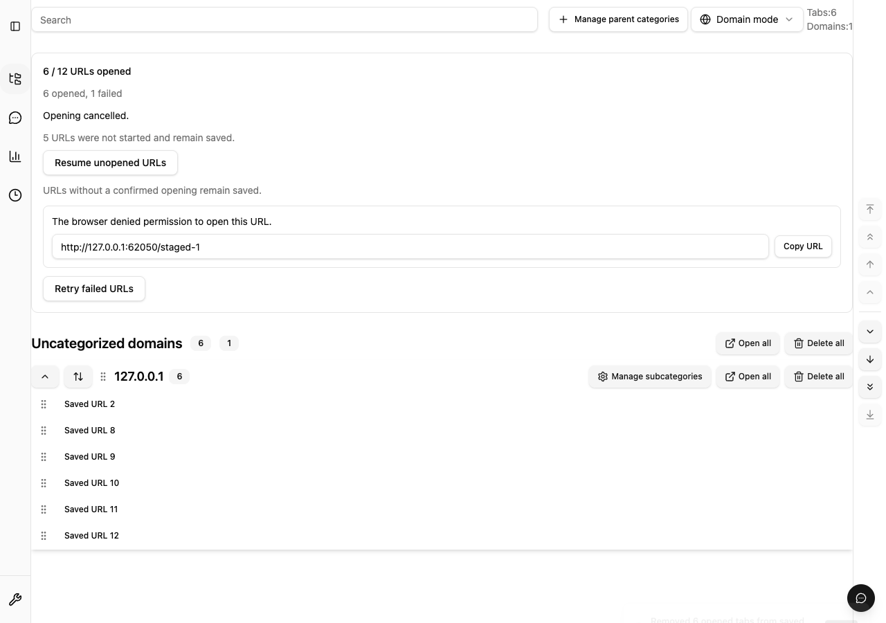

# 一括オープンの段階実行と実機計測

Issue #899 は #364 のプレビュー・重複除外・確認と #893 の安全な失敗表示を維持し、
一括オープンの作成処理を最大5件の pool にする。通常タブは完了するたびに次の1件を開始する。
新規ウィンドウは最初の最大5件を `windows.create` で開き、確認した `windowId` に残りを追加する。
作成を確認できないウィンドウへは追加せず、別ウィンドウへの fallback はしない。

UI は総件数・処理済み・成功・失敗を表示する。キャンセル後は未着手分を開始せず、
開始済みの作成結果を待つ。成功した分だけを既存の設定に従って保存データから削除し、
失敗分と未着手分を保存したままにする。「失敗したURLを再試行」と「未着手のURLを開く」は
対象を分け、累計の成功数と残りの対象を維持する。保存更新が失敗しても成功分を再試行へ混ぜない。
取消はタブ作成を取り消したり、作成済みタブを閉じたりする操作ではない。

## 測定条件と基準

[記録データ](staged-url-opening-baseline.json) は macOS arm64、Node 24.17.0 / Bun 1.3.14、
Chrome for Testing 153.0.8010.12 と Firefox 155.0 の各1サンプル。
一時プロファイルと専用 IndexedDB を使い、`about:blank` の一意な fragment を10/100/500件開く。
実際の browser adapter と native persistence session を使い、作成後の URL 読み出しを待たずに
タブ ID の差分で件数を確認する。Chrome のインストール時自動表示タブは計測開始前に待ち、基準へ含める。
各ケース後に作成したタブを閉じ、最終的に専用プロファイルを削除する。

- 正しさ: 作成・成功・削除が要求件数と一致し、失敗・残存保存URLは0件。対象ウィンドウは1つ。
- 作成負荷: 同時 native API 呼び出しは最大5件。新規ウィンドウの初回 URL 配列も最大5件。
- 応答性: 10ms timer の最大間隔と、最初の成功/失敗通知までの時間を記録する。
  この軽量 fixture では timer 間隔250ms超、最初の結果5秒超、500件30秒超を再調査の目安とする。
  これらの時間は手動測定の目安であり、CI gate や製品の timeout としては使わない。

全12ケースで件数・削除・失敗・ウィンドウ・同時作成数の基準を満たした。
時間は端末・ブラウザ状態に依存する。ページ読み込み、ネットワーク、総メモリ使用量の測定ではなく、
以前の無制限実行との速度改善率や一般的な性能保証を示すものではない。

| ブラウザ | 件数 | モード         | 作成・保存更新完了 | 最初の結果 | 最大timer間隔 |
| -------- | ---: | -------------- | -----------------: | ---------: | ------------: |
| Chrome   |   10 | backgroundTabs |             0.10秒 |       13ms |          12ms |
| Chrome   |   10 | newWindow      |             0.26秒 |       88ms |          11ms |
| Chrome   |  100 | backgroundTabs |             1.44秒 |       11ms |          11ms |
| Chrome   |  100 | newWindow      |             1.62秒 |      158ms |          11ms |
| Chrome   |  500 | backgroundTabs |             9.57秒 |       15ms |          12ms |
| Chrome   |  500 | newWindow      |            10.47秒 |      132ms |          12ms |
| Firefox  |   10 | backgroundTabs |             0.24秒 |       20ms |          13ms |
| Firefox  |   10 | newWindow      |             0.29秒 |      167ms |          14ms |
| Firefox  |  100 | backgroundTabs |             2.54秒 |       24ms |          15ms |
| Firefox  |  100 | newWindow      |             2.83秒 |      295ms |          26ms |
| Firefox  |  500 | backgroundTabs |            17.01秒 |       25ms |          40ms |
| Firefox  |  500 | newWindow      |            20.69秒 |     2972ms |         157ms |

## 再実行

通常の品質ゲートは変更しない。計測は手動で実行し、複数の測定や重いテストを並行実行しない。
先に依存関係と両ブラウザを準備する。geckodriver は公式 Mozilla リリース v0.37.1 を使用した。
`FIREFOX_EXECUTABLE_PATH` と `GECKODRIVER_PATH` は手元のインストール先を指定する。

```sh
bun install --frozen-lockfile
bun run build
bun run build:firefox
bun run build:firefox:indexeddb-smoke-harness
bun build e2e/support/staged-url-opening-measurements.ts \
  --outfile=.output/staged-url-opening-measurements.js \
  --target=browser --format=iife \
  --define 'import.meta.env={"DEV":false,"PROD":true,"MODE":"test"}'
bun tools/scripts/measure-staged-url-opening.ts
MEASURE_STAGED_URL_OPENING=1 \
  bun tools/scripts/firefox-persistence-indexeddb-smoke.ts
```

両 runner は欠落ケース、重複ケース、不正な数値、未確認作成、保存更新の不一致、
5件超の圧力を検出したら失敗する。Firefox runner は通常の保存・再起動 smoke も実行する。
Chrome runner は180秒で専用 context を閉じて測定を失敗させる。

## 回帰検証

- unit: pool の補充、要求順の結果、開始前/作成中の cancel、未確認ウィンドウ、observer 例外。
- native session: runtime 制御の引き渡し、quota/revision conflict 後の partition と close/reopen。
- UI: 直後/連打の cancel、別操作キューの分離、古い進捗通知、retry/resume 両順序の累計。
- E2E: 既存の確認画面から開始し、進捗→取消待機→失敗だけ再試行→未着手だけ再開を実操作する。
  保存状態と要求URLの一致も確認する。


