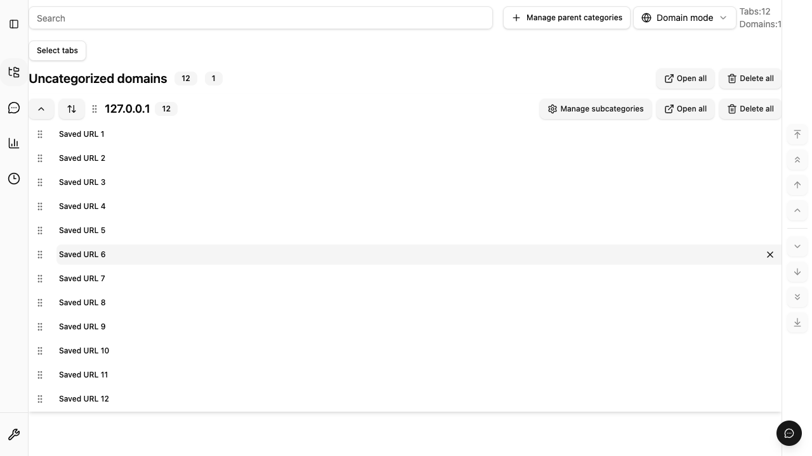
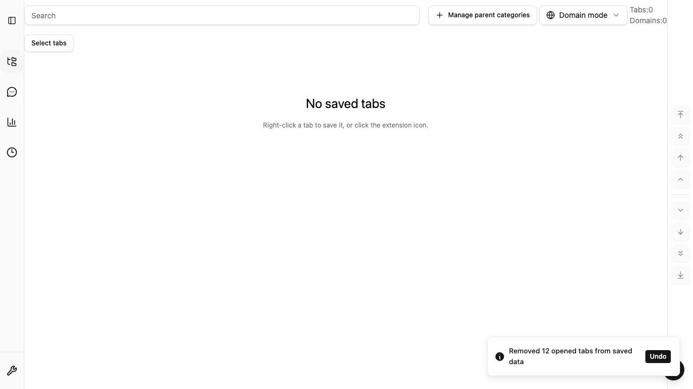

# 一括オープンの段階実行と実機計測

一括オープンは #364 のプレビュー・重複除外・確認を維持し、
Issue #899 で導入した最大5件の pool で作成する。通常タブは完了するたびに次の1件を開始する。
新規ウィンドウは最初の最大5件を `windows.create` で開き、確認した `windowId` に残りを追加する。
作成を確認できないウィンドウへは追加せず、別ウィンドウへの fallback はしない。
新規ウィンドウへの後続追加は `active: false` に固定し、最初のタブの選択を維持する。

進捗・成功件数・失敗一覧の結果パネルと、専用のキャンセル・再試行・再開操作は撤去した。
処理中も完了後も結果パネルを表示しない。失敗時は簡潔なエラー通知を出し、
開けなかったURLは保存一覧から通常のクリックや「すべて開く」で開き直せる。
成功を確認できたURLだけを既存の設定に従って保存データから削除する。
保存更新の失敗は、URLを開けなかった場合と区別して通知する。
自動削除後は、引き続きその操作の Undo 通知から保存データを復元できる。
別の操作はキューに積み、同じ操作の連打では重複して開かない。

## 現行UI

Chrome の実拡張 E2E で、12件を開く処理中と完了後を撮影した。
処理中は保存一覧を維持し、完了後は自動削除の設定に従って一覧が空になる。
どちらにも進捗・結果パネルを表示しない。完了後の Undo 通知は維持する。





## 導入時の測定条件と基準

[記録データ](staged-url-opening-baseline.json) は macOS arm64、Node 24.17.0 / Bun 1.3.14、
Chrome for Testing 153.0.8010.12 と Firefox 155.0 の各1サンプル。
一時プロファイルと専用 IndexedDB を使い、`about:blank` の一意な fragment を10/100/500件開く。
実際の browser adapter と native persistence session を使い、作成後の URL 読み出しを待たずに
タブ ID の差分で件数を確認する。開始前の全ウィンドウ ID も記録し、既存ウィンドウへの誤追加を検出する。
タブを開く設定は `active: true` とし、新規ウィンドウの後続追加が設定に影響されず先頭タブを維持するか確認する。
Chrome のインストール時自動表示タブは計測開始前に待ち、基準へ含める。
各ケース後に作成したタブを閉じ、最終的に専用プロファイルを削除する。

- 正しさ: 作成・成功・削除が要求件数と一致し、失敗・残存保存URLは0件。対象ウィンドウは1つ。
  `createdWindows` は作成タブの行先ウィンドウ数、`newWindows` は開始時の ID 集合との差分を示す。
  通常タブは新規ウィンドウ0件。新規ウィンドウモードは新規1件かつ全作成タブがその中にあり、
  完了後の先頭タブが active であることを native query で確認する。
- 作成負荷: 同時 native API 呼び出しは最大5件。新規ウィンドウの初回 URL 配列は `min(5, 件数)` 件。
- 応答性: 10ms timer の最大間隔と、最初の成功/失敗通知までの時間を記録する。
  この軽量 fixture では timer 間隔250ms超、最初の結果5秒超、500件30秒超を再調査の目安とする。
  これらの時間は手動測定の目安であり、CI gate や製品の timeout としては使わない。

全12ケースで件数・削除・失敗・ウィンドウ・同時作成数の基準を満たした。
時間は端末・ブラウザ状態に依存する。ページ読み込み、ネットワーク、総メモリ使用量の測定ではなく、
以前の無制限実行との速度改善率や一般的な性能保証を示すものではない。

| ブラウザ | 件数 | モード         | 作成・保存更新完了 | 最初の結果 | 最大timer間隔 |
| -------- | ---: | -------------- | -----------------: | ---------: | ------------: |
| Chrome   |   10 | backgroundTabs |             0.13秒 |       17ms |          12ms |
| Chrome   |   10 | newWindow      |             0.15秒 |       66ms |          12ms |
| Chrome   |  100 | backgroundTabs |             1.53秒 |       16ms |          11ms |
| Chrome   |  100 | newWindow      |             1.40秒 |       69ms |          12ms |
| Chrome   |  500 | backgroundTabs |            11.98秒 |       19ms |          26ms |
| Chrome   |  500 | newWindow      |            11.96秒 |      111ms |          12ms |
| Firefox  |   10 | backgroundTabs |             0.26秒 |       24ms |          14ms |
| Firefox  |   10 | newWindow      |             0.29秒 |      166ms |          13ms |
| Firefox  |  100 | backgroundTabs |             2.72秒 |       25ms |          15ms |
| Firefox  |  100 | newWindow      |             2.60秒 |      176ms |          16ms |
| Firefox  |  500 | backgroundTabs |            18.32秒 |       27ms |          27ms |
| Firefox  |  500 | newWindow      |            16.80秒 |      239ms |          16ms |

## 再実行

通常の品質ゲートは変更しない。計測は手動で実行し、複数の測定や重いテストを並行実行しない。
先に依存関係と両ブラウザを準備する。geckodriver は公式 Mozilla リリース v0.37.1 を使用した。
`FIREFOX_EXECUTABLE_PATH` と `GECKODRIVER_PATH` は手元のインストール先を指定する。

```sh
bun install --frozen-lockfile
bun run build
bun run build:firefox
bun run build:firefox:indexeddb-smoke-harness
bun build e2e/support/staged-url-opening-measurements.ts \
  --outfile=.output/staged-url-opening-measurements.js \
  --target=browser --format=iife \
  --define 'import.meta.env={"DEV":false,"PROD":true,"MODE":"test"}'
bun tools/scripts/measure-staged-url-opening.ts
MEASURE_STAGED_URL_OPENING=1 \
  bun tools/scripts/firefox-persistence-indexeddb-smoke.ts
```

両 runner は欠落ケース、重複ケース、不正な数値、未確認作成、保存更新の不一致、
誤った行先ウィンドウ、先頭タブ選択の喪失、初回 batch の不一致、5件超の圧力を検出したら失敗する。
Firefox runner は通常の保存・再起動 smoke も実行する。
Chrome runner は180秒で専用 context を閉じて測定を失敗させる。

## 回帰検証

- unit: pool の補充、要求順の結果、開始前/作成中の cancel、未確認ウィンドウ、observer 例外。
- native session: runtime 制御の引き渡し、quota/revision conflict 後の partition と close/reopen。
- UI: 別操作のキューと重複クリック抑止、簡潔な失敗通知、成功後の Undo。
- E2E: 既存の確認画面から開始し、処理中・成功後・失敗後に結果パネルが出ないことを確認する。
  成功URLだけの保存削除、失敗URLの保持と一覧からの再操作、Undo 後の再読み込みも確認する。

導入時の旧UIは[当時の記録画像](assets/issue-899-staged-opening.png)に残している。
